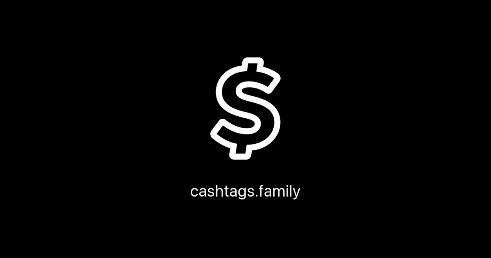
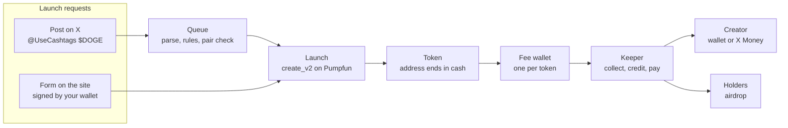

<p align="center">
  
</p>

<h1 align="center">Cashtags</h1>

<p align="center">
  <strong>Turn any cashtag into a tradable token.</strong><br>
  Tag <a href="https://x.com/UseCashtags">@UseCashtags</a> on X with a <code>$CASHTAG</code>, or launch from <a href="https://cashtags.family/launch">cashtags.family</a>, and a Pumpfun token goes live in seconds.
</p>

<p align="center">
  <a href="https://cashtags.family">Website</a> ·
  <a href="https://cashtags.family/launch">Launch</a> ·
  <a href="https://cashtags.family/explore">Explore</a> ·
  <a href="https://cashtags.family/payments">Payments</a> ·
  <a href="https://cashtags.family/docs">How it works</a> ·
  <a href="https://x.com/UseCashtags">X</a>
</p>

<p align="center">
  
  
  
  
</p>

---

## What it is

Cashtags is a launchpad that lives where tokens are talked about. FOMO lets anyone trade a Solana token by tapping its cashtag on X, so a token launched from a post can be traded from the same timeline a moment later.

There is no smart contract of our own. Every token is a standard Pumpfun token with an address ending in `cash`. Cashtags adds the parts around it: reading the post, launching the token, and routing the creator rewards to whoever they belong to.

## Two ways to launch

| | From X | On the site |
|---|---|---|
| **How** | Post `@UseCashtags $DOGE` | Fill in the form at [cashtags.family/launch](https://cashtags.family/launch) |
| **Cost** | Free. Cashtags pays the network cost. | About 0.01 SOL, paid from your own wallet. |
| **Sign in** | Your post is your identity. | X or a Solana wallet. |
| **Image** | The picture on your post. | Upload one. |
| **Dev buy** | No. | Optional, in the same transaction as the launch. |
| **Limits** | 25 followers, a 14 day old account, one launch per 30 minutes. | None beyond the cashtag rule. |

Both follow one rule that protects a token once it exists: a cashtag can be launched once every 24 hours.

### From X

```
@UseCashtags $DOGE
@UseCashtags launch $DOGE Doge Coin
@UseCashtags launch $PILL paired with $PUMP
@UseCashtags launch $GM for @yourfriend
```

The bot replies with the contract address. A post can name a pair (any token on Pumpfun's pair list, or any Pumpfun coin by address) and can launch a token for someone else.

### On the site

Pick a cashtag, a name and an image, choose where the creator rewards go, and optionally add a dev buy. Your wallet signs one transaction that creates the token and makes your buy before anyone else can trade.

## Where the creator rewards go

Pumpfun pays a creator reward on every trade. Cashtags takes no cut of it.

| Choice | What happens |
|---|---|
| **X Money** | The rewards belong to an X account and are paid in dollars to its X Money. Use your own handle, or someone else's to launch the token for them. They do not need to sign in or do anything. |
| **Holders** | The token launches with Pumpfun holder rewards. Pumpfun pays the rewards to the token's holders directly, for the life of the token. |
| **Wallet payouts** | An X account that signs in can instead withdraw to any Solana wallet, or set automatic payouts to a wallet or a FOMO wallet. |

Rewards are tied to an X account's permanent id, never its handle, so a rename changes nothing. Every payment Cashtags sends is listed publicly on the [Payments](https://cashtags.family/payments) page with its transaction.

## How it works



**One fee wallet per token.** Each token's Pumpfun creator is its own wallet, derived from a seed and the token's address. Its balance is always the rent floor plus a creator bucket plus a holders bucket. The keeper credits whatever arrives to the token's setting at that moment, and only ever moves what was credited.

**Launches from X** are paid by a launch wallet. A request is claimed with a conditional database update before anything is signed, its signature is written down before the first send, and a restart settles every unfinished launch from what the chain says.

**Launches on the site** are paid by the launcher. The server builds the transaction with the launcher's wallet as fee payer, simulates it, and hands it over unsigned. The wallet signs and returns it without sending. The server checks that the message is byte for byte the one it built (a wallet may only add its own guard instructions), verifies the wallet's signature, and only then adds the mint key's signature and sends. A transaction carrying the mint key's signature never leaves the server unsent.

**Paying out.** Every outflow is recorded as `sending` before it is sent and is settled only by a positive answer from the chain. A transaction is treated as expired only when the chain confirms its blockhash has passed and the signature is still unknown. An RPC error is never read as a failure, so nothing is paid twice.

**X Money** payouts travel from SOL to USDC on Base and are sold through Peer to a buyer who pays the creator's X Money. Peer verifies the payment before releasing the USDC. If nobody pays in time, the rewards return to the creator's balance.

## Repository layout

```
api/          Node server: HTTP API, the X bot, the keeper, launches, payouts
  bot.mjs         reads mentions, works the queue, replies
  parse.mjs       turns a post into a launch request
  guards.mjs      who may launch, and how often
  launch.mjs      builds and settles Pumpfun launches
  sitelaunch.mjs  launches from the site, signed by the launcher's wallet
  keeper.mjs      collects fees, credits buckets, pays creators, airdrops holders
  xmoney.mjs      X Money payouts through Relay and Peer
  buyback.mjs     buys back and burns the project token with its own rewards
  market.mjs      prices and market caps for the site
lib/          Pumpfun and PumpSwap client, transaction sending, lookup tables
web/          The site: Vite, React, TypeScript, no UI framework
tests/        Unit tests, and end to end tests on a local validator
scripts/      Local development, probes and read-only mainnet checks
tools/grind/  Rust grinder for token addresses that end in cash
deploy/       systemd units and an example of the environment file
```

The API uses `node:http` and `node:sqlite` directly. There is no web framework, no ORM and no on-chain program to deploy.

## Run it locally

You need Node 22 or newer and the Solana CLI (for `solana-test-validator`).

```bash
npm ci
(cd web && npm ci)

# throwaway fixtures for the pair tests
node tests/fixtures/make-fixtures.mjs

# unit tests: no chain, no network
npm test

# end to end: a local validator with Pumpfun cloned from mainnet
./run-tests.sh
```

The end to end suite launches real Pumpfun tokens on the local validator, trades them, collects fees, pays creators, airdrops holders, runs an X Money payout against local stand-ins, and launches from the site with a wallet signature and a dev buy. Every number is checked against the chain.

To click through the site against the local validator:

```bash
./validator.sh &                 # local chain on port 8891
node scripts/dev-site.mjs        # API on port 5570, sample tokens and payments
(cd web && npm run dev)          # site on http://localhost:5575
```

Sign in as a test account at `http://localhost:5575/api/auth/x/start?as=alice&return=/launch`. The test sign-in only exists when `DEV_STUBS=1` and is refused on an https origin.

## Configuration

Everything is set through environment variables. `deploy/secrets.env.example` lists them with comments. The main ones:

| Variable | Purpose |
|---|---|
| `RPC_URL` | Solana RPC endpoint |
| `FEE_SEED` | Derives every token's fee wallet. Back it up and never rotate it once a token exists. |
| `LAUNCH_KEY`, `KEEPER_KEY` | Wallets that pay for launches from X, and for collecting and paying out |
| `X_CLIENT_ID`, `X_CLIENT_SECRET` | Sign in with X (OAuth 2.0 with PKCE) |
| `TWITTERAPI_IO_KEY` | Reading mentions and replying |
| `PINATA_JWT` | Pinning token images and metadata |
| `XMONEY_ENABLED` | Turns X Money payouts on |
| `LAUNCH_LUT` | Lookup table a dev buy needs. `scripts/make-launch-lut.mjs` creates it. |

No secret belongs in this repository. Keys and the environment file live outside it, and `.gitignore` excludes them.

## Safety notes for anyone reading the code

- Token metadata on Pumpfun has no update authority. Name, cashtag, image and links are permanent, so everything is validated before it is pinned.
- A mint key is used for one attempt. Once a transaction carrying it has been sent, a failed attempt burns the key instead of reusing it.
- Amounts in different assets are never added together. A token paired with another token earns its rewards in that token, and its ledger rows are in that token's units.
- The price of a graduated token is read from its PumpSwap pool as the vault balance plus the pool's virtual quote reserves. The balance alone reads far too low on a small pool.
- Sign-in with a wallet uses a one-time message that is bound to the address and expires after ten minutes.

## Disclaimer

Tokens launched with Cashtags are created by whoever launches them. Cashtags does not endorse any token, and trading them can lose you everything you put in. This software is provided as is, without warranty of any kind.

## License

[MIT](LICENSE)
